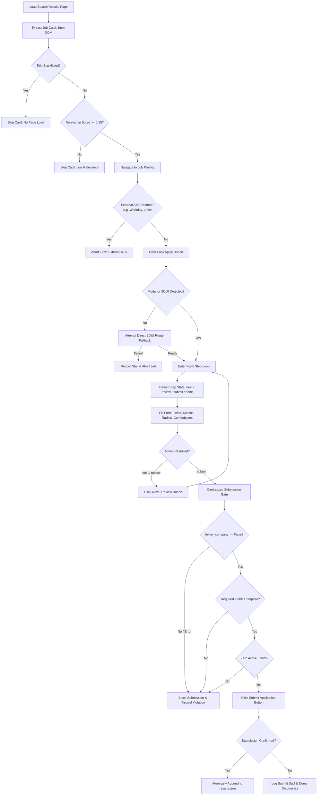

# EasyApply Automator

Engineering documentation for EasyApply Automator: a Python-based automation framework for LinkedIn Easy Apply applications with deterministic form resolution, multi-tier QA resolution, centralized submission verification, and structured observability.

---

## 1. Project Purpose & Scope

EasyApply Automator is designed to automate the discovery and submission flow for job postings offering LinkedIn Easy Apply. The system prioritizes deterministic rule matching, idempotent DOM interactions, strict validation gates, and humanized session pacing to provide predictable, inspectable automation.

### Current Implementation Status

| Capability | Status | Description |
| :--- | :--- | :--- |
| Job Search & Pre-Filtering | [Implemented] [Tested] | Scrapes job cards across search pagination, skips blacklisted titles and low-relevance postings before full page load. |
| External ATS Detection | [Implemented] [Tested] | Detects redirects to third-party ATS platforms (Workday, Greenhouse, Lever, etc.) and aborts gracefully. |
| SDUI & Modal Flow Engine | [Implemented] [Tested] | State machine supporting both standard modals and Server-Driven UI (SDUI) `/apply/?openSDUIApplyFlow=true` routes. |
| Multi-Tier QA Pipeline | [Implemented] [Tested] | 5-stage cascade: deterministic YAML regex rules, dynamic skill years, recruitment heuristics, LLM fallback, and default values. |
| Follow Company State Controller | [Implemented] [Tested] | Idempotent state-setting controller ensuring `follow_company == False` before submission across both SDUI custom components and legacy checkboxes. |
| Centralized Submission Gate | [Implemented] [Tested] | Pre-submission validator verifying 5 critical invariants before triggering submission. |
| Human Simulation Pacing | [Implemented] [Tested] | Randomized pauses, typing variance jitter, and cubic Bezier mouse trajectories. |
| Adaptive Circuit Breaker | [Implemented] [Tested] | Escalating cooldowns (60s to 300s) triggered after 3 consecutive submission failures. |
| Observability & Snapshots | [Implemented] [Tested] | Append-only structured JSONL telemetry (`logs/events.jsonl`) and HTML/DOM debug snapshots upon stalls or failures. |
| Local Web Control Center | [Implemented] [Tested] | Flask dashboard (`dashboard.py`) for metrics exploration, QA simulation, and YAML rule editing. |
| Headless Execution with Session Cookies | [Implemented] [Tested] | Cookie serialization (`.auth/linkedin_cookies.json`) allowing persistent sessions without repeated manual authentication. |
| Automated Captcha Solving | [Planned] | Not supported. Manual user intervention is required for CAPTCHA challenges or security checkpoints. |

---

## 2. System Architecture

The codebase follows Clean Architecture principles, decoupling domain abstractions, application orchestration, browser infrastructure, and presentation services.

```text
+-----------------------------------------------------------------------------------------+
|                                EasyApply Automator Core                                 |
+----------------------------+----------------------------+-------------------------------+
|     Application Layer      |       Services Layer       |     Infrastructure Layer      |
|  +----------------------+  |  +----------------------+  |  +-------------------------+  |
|  | Orchestrator /       |  |  | ApplyFlowService     |  |  | Undetected ChromeDriver |  |
|  | SearchLoopMixin      |--|  | SubmitFlowMixin      |--|  | Browser Driver Factory  |  |
|  +----------------------+  |  | FormFillerMixin      |  +-------------------------+  |
|             |              |  +----------------------+               |               |
|  +----------------------+  |             |              +-------------------------+  |
|  | Web Dashboard        |  |  +----------------------+  | Human Simulation:       |  |
|  | Flask Control Center |  |  | QuestionService      |  | Bezier Curves, Jitter,  |  |
|  +----------------------+  |  | DiagnosticsService   |  | Adaptive Circuit Breaker|  |
|                            |  +----------------------+  +-------------------------+  |
+-------------+--------------+-------------+--------------+---------------+---------------+
              |                            |                              |
    +-------------------+        +--------------------+        +---------------------+
    | questions_answers |        | Universal LLM API  |        | Atomic JSONL Logs & |
    | Local YAML Engine |        | Groq/Gemini/Claude |        | HTML Failure Dumps  |
    +-------------------+        +--------------------+        +---------------------+
```

### Layer Responsibilities

1. **Application Layer (`easy_apply_automator/app/`)**:
   * `LinkedInEasyApplyOrchestrator`: Coordinates session lifecycle, search loops, rate limiting, and debug traces.
   * `SearchLoopMixin`: Handles pagination, search filter query generation, and job card iteration.
   * `runner.py`: CLI entry point parsing command-line parameters and orchestrating shutdown signals.
2. **Domain Layer (`easy_apply_automator/domain/`)**:
   * `models.py`: Strongly typed dataclasses (`AppConfig`, `RuntimeConfig`, `SessionMetrics`, `JobMetadata`).
3. **Services Layer (`easy_apply_automator/services/`)**:
   * `ApplyFlowService`: Composes form interaction and submission workflows via `FormFillerMixin` and `SubmitFlowMixin`.
   * `QuestionService`: Form field extraction, question cleansing, numeric coercion, and typeahead handling.
   * `DiagnosticsService`: DOM stall diagnostics, metadata parsing, and selector verification.
   * `ThroughputService` & `SessionService`: Real-time application pacing, quota enforcement, and session telemetry.
4. **QA Layer (`easy_apply_automator/qa/`)**:
   * `AutoAnswer`: Evaluates candidate profile rules and dispatches to LLM when needed.
   * `LLMClient`: Dependency-free REST client supporting Groq, Google Gemini, OpenAI, Anthropic Claude, and local Ollama endpoints.
   * `RelevanceScorer`: Fast heuristic keyword scoring matching candidate skills against job titles and descriptions.
5. **Infrastructure Layer (`easy_apply_automator/infra/`)**:
   * Browser automation via Selenium and `undetected-chromedriver`.
   * Human simulation: randomized micro-pauses, typing cadence jitter, and Bezier mouse movement.
   * `AdaptiveCircuitBreaker`: Failure burst detection and progressive cooldown timers.
6. **Observability Layer (`easy_apply_automator/observability/`)**:
   * Structured logging, atomic JSONL event emission, and HTML debug snapshots.

---

## 3. Repository Layout

```text
EasyApply-Automator/
├── config.yaml                    # Search criteria, locations, filters, and pacing limits
├── locators.yaml                  # Decoupled Page Object Model selectors for LinkedIn DOM
├── questions_answers.yaml         # Deterministic regex rules and skill experience profile
├── resume.md                      # Candidate resume in Markdown format (context for LLM fallback)
├── dashboard.py                   # Control Center Web Dashboard launcher
├── easy_apply_bot.py              # CLI entry point to launch automation
├── run.bat                        # Windows interactive launcher
├── run.sh                         # Linux / macOS interactive launcher
├── pyproject.toml                 # Project metadata, dependencies, ruff, mypy, and pytest config
├── requirements.txt               # Pinned runtime dependencies
├── easy_apply_automator/
│   ├── app/                       # Runner, Orchestrator, Search Loop engine
│   ├── config/                    # YAML loaders and configuration schemas
│   ├── dashboard/                 # Flask backend and dashboard UI
│   ├── domain/                    # Domain dataclasses and models
│   ├── infra/                     # Browser factory, repositories, human simulation
│   ├── observability/             # Structured JSONL logging and run summaries
│   ├── qa/                        # AutoAnswer engine, RelevanceScorer, LLM client
│   └── services/                  # Form filling, submission flow, question parsing
├── debug/                         # HTML and JSON trace snapshots for inspected jobs
├── logs/                          # Daily application run logs and events.jsonl
├── results/                       # Dated JSON results of processed, applied, and skipped jobs
└── tests/                         # Automated unit and integration test suite (347 tests)
```

---

## 4. End-to-End Workflow & State Machine



---

## 5. Centralized Submission Gate & Follow Company Checkbox Controller

### Problem Addressed
On the final application review step, LinkedIn presents an opt-out checkbox:
`Follow <Company> to stay up to date with their page` (e.g. "Follow The Information Company (TIC) to stay up to date with their page").
In modern LinkedIn Server-Driven UI (SDUI), this element is rendered as a custom component (`div[role='checkbox']` with dynamic input ID `_r_10_`) rather than the legacy static ID `follow-company-checkbox`.

### State-Setting Controller Implementation
Located in `easy_apply_automator/services/_form_filler.py` as `set_follow_company_state(desired_state=False, require_present=True)`:
1. **Multi-Strategy Locators**: Resolves `div[role='checkbox'][aria-label*='Follow ' i]`, text-anchored containers matching `follow .* to stay up to date`, and legacy IDs.
2. **Dual-Signal Inspection**: Evaluates both `aria-checked` on the semantic control and `.is_selected()` on the associated `<input type='checkbox'>`.
3. **Idempotence**: If the checkbox is already in the desired state (`False`), no click is performed.
4. **Controlled Transition**: If checked, clicks the accessible control (`label` or `div[role='checkbox']`), re-inspects state, and retries once using the alternate associated control if needed.
5. **Strict Verification**: If the state cannot be verified or remains checked, returns a structured error. Repeated calls never toggle the checkbox back on.

### Centralized Submission Invariants
Located in `easy_apply_automator/services/_submit_flow.py` as `validate_final_submission_invariants()`:
Before clicking `Submit application`, the gate verifies 5 critical invariants:
1. `follow_company == False`: Verified via the state controller.
2. `required_fields_complete`: No empty required text inputs, radios, or comboboxes.
3. `required_uploads_attached`: Resume and required documents attached.
4. `no_unresolved_validation_errors`: Zero active `.artdeco-inline-feedback--error` messages.
5. `modal_valid_state`: Application container is open and the submit button is present and enabled.

If any invariant fails:
* Submission is immediately aborted.
* A structured event `submission_invariant_failed` is emitted.
* An HTML failure dump `invariant_<name>_failed` is captured in `debug/failed/`.
* Control is returned safely to the orchestrator.

---

## 6. Multi-Tier QA Resolution Pipeline

When Easy Apply forms present screening questions, `AutoAnswer` resolves them through a deterministic-first pipeline:

```text
[Incoming Form Question]
         │
         ▼
1. Deterministic YAML Regex Rules (`questions_answers.yaml`)
   ├── Matched -> Returns configured answer (0ms latency, zero API cost)
   └── Unmatched
         │
         ▼
2. Dynamic Skill Years Extraction
   ├── Matches target keywords -> Extracts integer years from `profile.years`
   └── Unmatched
         │
         ▼
3. Recruitment Heuristics
   ├── Standard questions (notice period, sponsorship, commute, degree completion)
   └── Unmatched
         │
         ▼
4. Zero-Shot LLM Reasoning (`LLMClient`)
   ├── Formulates prompt with question, job context, and candidate `resume.md`
   ├── Enforces bounded HTTP timeout (10-15s)
   ├── Validates model output (sanitizes length, strips boilerplate)
   ├── Persists novel answer to `questions_answers.yaml` (if auto-learn is enabled)
   └── Provider unavailable / Timeout / Empty
         │
         ▼
5. Safe Defaults Fallback
   └── Emits configured default (`unknown_text` or `unknown_years`)
```

### Self-Learning Guardrails
To prevent corrupted rules:
* Character counter text (e.g. `29 of 100 characters` or `0/500 characters`) is stripped and never queried to LLMs or saved as rules.
* File names (`.pdf`, `.docx`) are rejected from question parsing.
* AI auto-learned rules are prevented from overwriting deterministic rule IDs.

---

## 7. Configuration Model

Configuration is partitioned into 3 distinct layers:

### 1. Environment Secrets (`.env` - Gitignored)
```env
# LinkedIn Credentials
LINKEDIN_USERNAME=your_email@example.com
LINKEDIN_PASSWORD=your_password

# Personal Profile Data
LINKEDIN_FULL_NAME=Your Full Name
LINKEDIN_FIRST_NAME=YourFirstName
LINKEDIN_LAST_NAME=YourLastName
LINKEDIN_EMAIL=your_email@example.com
LINKEDIN_PHONE_NUMBER=9876543210
LINKEDIN_LOCATION_COUNTRY=IN
LINKEDIN_LOCATION_CITY=Mumbai
LINKEDIN_SALARY=1000000

# Optional AI Engine Configuration
GROQ_API_KEY=gsk_your_groq_api_key
AI_PROVIDER=groq
AI_MODEL=openai/gpt-oss-120b
AI_AUTO_LEARN=1
```

### 2. Operational Search Configuration (`config.yaml`)
```yaml
positions:
  - "Software Engineer Intern"
  - "Python Developer"
  - "Backend Developer"

locations:
  - Mumbai
  - Remote
  - Bengaluru

workplace_types:
  - remote
  - hybrid
  - onsite

experience_level:
  - 1  # Internship
  - 2  # Entry level

max_applications: 40
follow_company: false

session_duration_hours_min: 2
session_duration_hours_max: 4
short_break_min_seconds: 15
short_break_max_seconds: 45
short_break_every_min_minutes: 30
short_break_every_max_minutes: 60
shuffle_search_combos: true

blacklist_titles:
  - "founder's office"
  - "sales executive"
  - "digital marketing"
  - "business development"
```

### 3. Decoupled Selectors Registry (`locators.yaml`)
```yaml
next: ["css", "button[aria-label='Continue to next step']"]
review: ["css", "button[aria-label='Review your application']"]
submit: ["css", "button[aria-label='Submit application']"]
error: ["class", "artdeco-inline-feedback__message"]
follow: ["css", "label[for='follow-company-checkbox'], div[role='checkbox'][aria-label*='Follow ' i], div[role='checkbox'][aria-label*='follow' i]"]
follow_checkbox: ["css", "input#follow-company-checkbox, div[role='checkbox'][aria-label*='Follow ' i], div[role='checkbox'][aria-label*='follow' i]"]
upload_resume: ["xpath", "//*[contains(@id, 'jobs-document-upload-file-input-upload-resume')]"]
upload_cv: ["xpath", "//*[contains(@id, 'jobs-document-upload-file-input-upload-cover-letter')]"]
```

---

## 8. Observability & Event Schema

All operational events are logged to standard output and appended to `logs/events.jsonl` in structured JSON format:

```json
{
  "timestamp": "2026-10-08T14:02:46.120",
  "event": "question_answered",
  "job_id": "4475730641",
  "kind": "required_radio_recovery",
  "question": "Have you completed the following level of education: Bachelor's Degree?*",
  "answer": "Yes"
}
```

### Key Event Types

| Event Name | Attributes | Description |
| :--- | :--- | :--- |
| `job_processed` | `job_id`, `job_title`, `company`, `result`, `reason` | Emitted when a job card completes evaluation or submission. |
| `easy_apply_step_enter` | `loop`, `progress` | Records entry into an Easy Apply modal form step. |
| `submission_invariants_verified` | `None` | Emitted when all 5 submission gate invariants pass. |
| `submission_invariant_failed` | `violations`, `diagnostics` | Emitted when the submission gate blocks submission. |
| `circuit_breaker_cooldown` | `duration_seconds` | Emitted when 3 consecutive failures trigger a cooldown break. |
| `results_write_ok` | `record`, `results_json` | Confirms atomic persistence of application record to disk. |

---

## 9. Local Setup & Execution

### Prerequisites
* Python 3.12 or newer.
* Google Chrome installed on the host machine.

### Installation Steps

```bash
# 1. Clone repository
git clone https://github.com/Romil157/EasyApply-Automator.git
cd EasyApply-Automator

# 2. Create virtual environment
python -m venv venv
source venv/bin/activate       # Linux / macOS
venv\Scripts\activate          # Windows

# 3. Install package with dev dependencies
pip install -e ".[dev]"

# 4. Initialize configuration templates
cp .env.example .env
cp questions_answers.example.yaml questions_answers.yaml

# 5. Provide candidate resume
# Save your resume content in Markdown inside resume.md
```

### Running the System

```bash
# Start Easy Apply automation
python easy_apply_bot.py

# Launch the Web Control Center dashboard on port 5000
python dashboard.py --port 5000

# Execute the test suite
pytest
```

---

## 10. Testing Strategy

The test suite contains **347 automated tests** spanning unit logic, DOM parsing, state machine flows, and regression gates:

```bash
# Run full pytest suite
pytest -v

# Run with coverage report
pytest --cov=easy_apply_automator --cov-report=term-missing

# Run code style and import linter
ruff check easy_apply_automator tests

# Run static type checking
mypy easy_apply_automator
```

### Regression Test Coverage (`tests/test_submission_gate_and_follow_checkbox.py`)
* `test_selected_checkbox_becomes_unchecked`: Verifies selected checkbox is toggled to unchecked.
* `test_already_unchecked_remains_unchecked`: Verifies already unchecked checkbox is left untouched without clicks.
* `test_normalization_is_idempotent`: Verifies repeated sequential calls never toggle checkbox back on.
* `test_dom_changes_retry_works`: Verifies retry mechanism toggles alternate control when first attempt fails.
* `test_missing_checkbox_blocks_submission_when_required`: Verifies missing checkbox blocks submission.
* `test_final_state_cannot_be_verified_blocks_submission`: Verifies unverified state blocks submission.
* `test_unrelated_checkboxes_are_not_modified`: Verifies job alert switches and terms checkboxes are ignored.
* `test_exact_regression_case_from_tic_screenshot`: Verifies exact TIC SDUI component structure from production logs.
* `test_submission_gate_blocks_on_validation_errors`: Verifies active validation errors block submission.
* `test_submission_gate_passes_when_all_invariants_satisfied`: Verifies gate passes and permits submission when clean.

---

## 11. Security & PII Protection

* **Source Control Hygiene**: Credentials (`LINKEDIN_USERNAME`, `LINKEDIN_PASSWORD`), phone numbers, email addresses, and `resume.md` are ignored by git.
* **Telemetry Sanitization**: Passwords and session cookies are never logged to `events.jsonl` or written to debug snapshots.
* **Cookie Storage**: Saved session cookies are stored in `.auth/linkedin_cookies.json`, which is explicitly gitignored.
* **No Bypass Capabilities**: This tool does not contain mechanisms to bypass CAPTCHAs, circumvent rate limits, or defeat platform access controls.

---

## 12. Known Limitations & Operational Considerations

1. **LinkedIn Rate Limits**: LinkedIn enforces rolling limits on daily Easy Apply submissions (typically 50–100 applications per 24-hour window). Exceeding this limit triggers a daily limit modal that the bot detects and exits from gracefully.
2. **Platform A/B Tests**: LinkedIn frequently alters DOM component hierarchies. When selectors shift, update `locators.yaml` to realign page object queries.
3. **Session Checkpoints**: If LinkedIn presents SMS 2FA or a security puzzle, launch the bot with `headless: false` to complete the verification manually once; cookies will be cached for subsequent runs.

---

## 13. Engineering Roadmap

* `[Implemented]` Server-Driven UI (SDUI) progress bar and step transition support.
* `[Implemented]` Idempotent follow company checkbox state controller.
* `[Implemented]` Centralized pre-submission invariant gate.
* `[Implemented]` Adaptive circuit breaker with progressive cooldowns.
* `[Implemented]` Universal lightweight LLM client with self-learning YAML cache.
* `[Planned]` Headless multi-session profile switching.
* `[Planned]` Prometheus metrics exporter endpoint.
* `[Planned]` Webhook notifications for completed sessions (Discord/Slack).

---

## License

Distributed under the **MIT License**. See [`LICENSE`](LICENSE) for complete terms.
